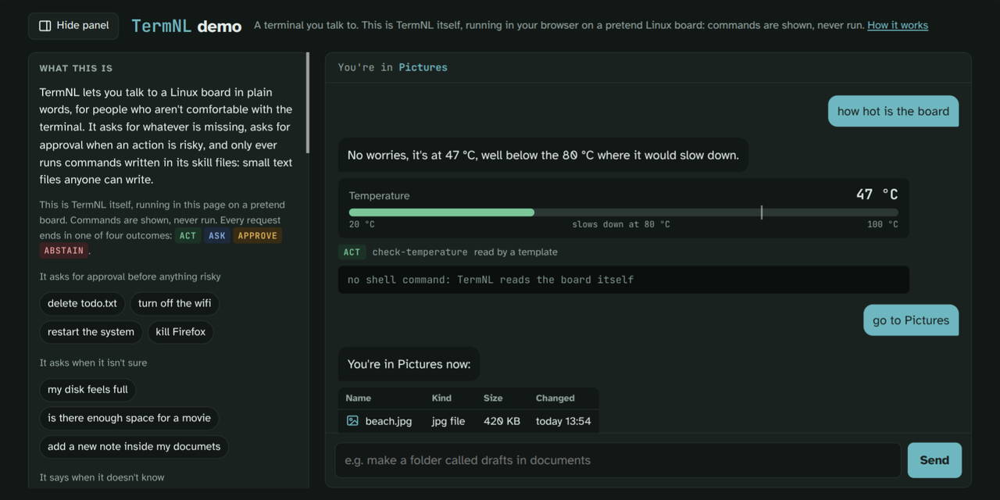
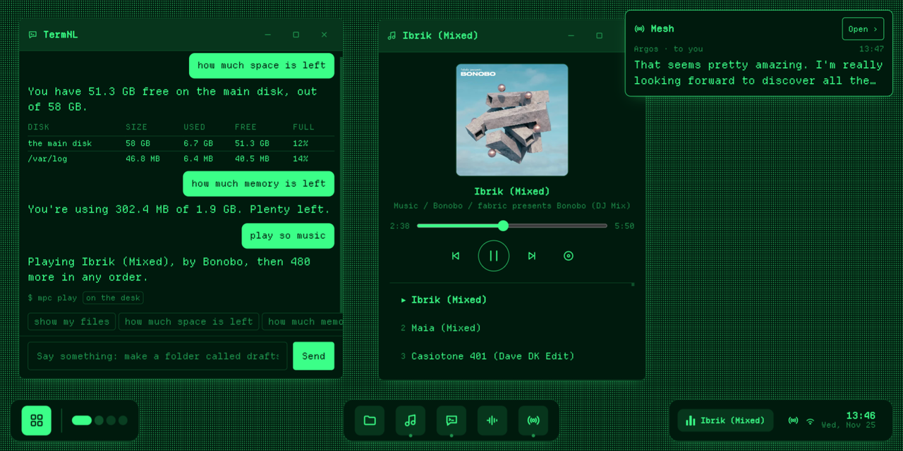

# Gabriel Baude

Designer and maker, founder of [The Cube](https://thecu.be).

For over 20 years, I've developed design and innovation concepts for international companies such as Huawei, Orange and Allianz, most recently as Head of Innovation, Design & Creative Technology. In 2018, long before generative AI went mainstream, I built Senz at Allianz, a machine-learning platform that turned hand-drawn sketches into working prototypes.

That work changed how I see the designer's role: when technology makes nearly anything possible, ethics, critical thinking and conscious decisions about what not to design matter more than ever. Since 2024, I work independently as a fractional principal designer: problem framing, discovery prototyping and applied research. I focus on privacy by design, local-first systems and people's agency, for the European market, where I believe this matters most.

So I build small, local, readable systems: models you can see into, teach in plain text, and run on modest hardware. When they're unsure, they ask.

## Projects

<table>
<tr>
<td width="50%" valign="top">

### [TermNL](https://github.com/msieur-gab/TermNL)

**Start here:** [TermNL](https://github.com/msieur-gab/TermNL), a terminal you talk to. Say what you want in plain words, and it runs the board's real commands, but only those written in its skills: small text files anyone can write. When something is missing, it asks. When it isn't sure, it says so. Before anything risky, it waits for your yes. A small natural language understanding model, offline, trained on the board itself. [Try it in your browser](https://msieur-gab.github.io/TermNL/demo/).

</td>
<td width="50%" valign="top">

### SymbiOS

An operating system that lives on any screen, made to give people back agency over their own computer. A very small board brings the mind (your files, notes, music, and small models for voice and search); the screen it is plugged into, a laptop, a TV, a phone, lends the body. Apart, each is half a computer; together, a whole one that is only yours: no cloud, no account, and only your phone can open it. TermNL is its terminal. The code will be public soon.

</td>
</tr>
</table>

Get in touch on [LinkedIn](https://www.linkedin.com/in/gabrielbaude/).
